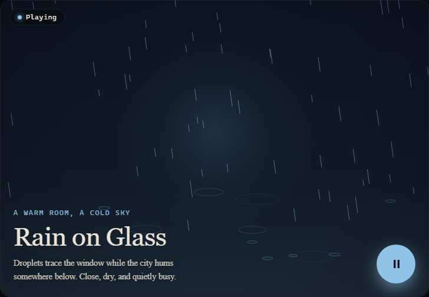
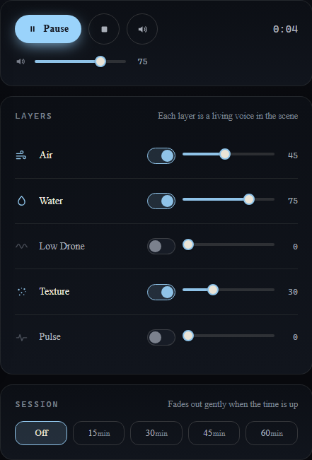
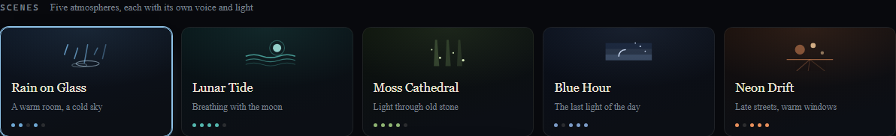
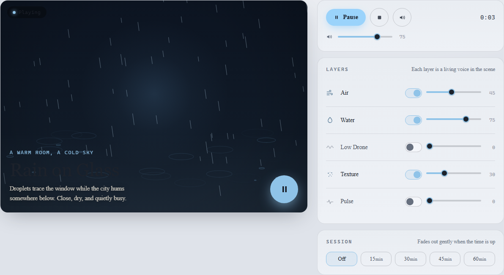
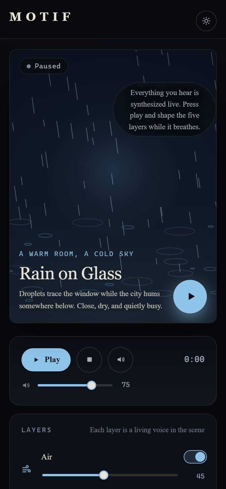

# MOTIF

A soundscape atelier: compose living atmospheres for focus, calm, reading, and
drift. Less a dashboard, more an instrument you enter. Every sound is
synthesized live in your browser with the Web Audio API: no recordings, no
network calls, nothing collected.

[](https://motif-liard-three.vercel.app)
[](https://github.com/devtechedge/motif/actions/workflows/ci.yml)


## Live Demo

**https://motif-liard-three.vercel.app**

> The deployed app is the complete product, not a demo subset. It is fully
> client-side: every sound is synthesized locally in your browser, and saved
> mixes stay in your browser's local storage. Headphones recommended.

## Screenshots

| The sound field (Rain on Glass, playing) | The layer mixer |
| --- | --- |
|  |  |

| Scene library | Light theme |
| --- | --- |
|  |  |



## What's inside

- **Five curated scenes.** Rain on Glass, Lunar Tide, Moss Cathedral, Blue
  Hour, Neon Drift. Each is a different synthesis recipe, palette, and visual
  identity.
- **A five-layer procedural mixer.** Air, Water, Low Drone, Texture, and
  Pulse. Every toggle and slider changes the real gain of a real synthesis
  voice: filtered noise beds, Poisson-scheduled raindrops, LFO-swollen tides,
  drips into a damped echo, detuned drone partials, vinyl crackle, pentatonic
  shimmer, formant-filtered choir, and rhythmic plucks.
- **A generative sound field.** An original canvas renderer per scene, driven
  by an `AnalyserNode` on the master bus, so the visuals breathe with the
  actual audio and the mix you shape.
- **Transport.** Play/pause, stop and reset, mute, master volume, elapsed
  clock. Audio starts only on an explicit gesture and every transition is
  ramped to avoid clicks.
- **Session timer.** 15/30/45/60 minutes with a slow fade-out and a quiet
  two-note bell on completion.
- **Shelf.** Save named mixes (scene, layer mix, master volume) to local
  storage; load and delete them. If storage is blocked, the app says so and
  keeps saves for the session.
- **Dark and light themes**, persisted, with no flash on load, plus reduced
  motion support and full keyboard access.

## Stack

| Layer | Choice |
| --- | --- |
| UI | React 19, TypeScript 5.9 (strict) |
| Build | Vite 7 |
| Audio | Web Audio API, custom synthesis engine (no samples) |
| Visuals | Canvas 2D, custom generative renderers |
| Tests | Vitest (29 unit tests), Playwright (5 e2e smokes) |
| Hosting | Vercel (static) |

## Quick start

```bash
npm install
npm run dev
```

Then open the printed local URL. Headphones recommended.

```bash
npm test            # unit tests
npm run e2e         # Playwright smokes (builds and serves the app first)
npm run typecheck   # tsc --noEmit
npm run lint        # eslint
npm run build       # typecheck + production build
```

## How the sound is made

The engine in `src/audio/` builds each scene from five voice types:

- **Air**: pink noise through a slowly swept bandpass.
- **Water**: rain (steady hiss plus randomly scheduled glassy droplets), tide
  (LFO-swollen filtered noise with foam hiss), or drip (sparse drops into a
  damped feedback delay).
- **Low Drone**: detuned sine partials with sub-octave and fifth, slow
  amplitude breathing, and cent-level detune drift.
- **Texture**: vinyl crackle, pentatonic shimmer, or a formant-filtered choir.
- **Pulse**: a rhythmic sine pluck pattern per scene, from a heartbeat to an
  arpeggio.

Voices sit on per-layer buses feeding a master gain and gentle compressor.
Scene changes crossfade; the graph is disposed cleanly on teardown.

## License

[MIT](LICENSE)
